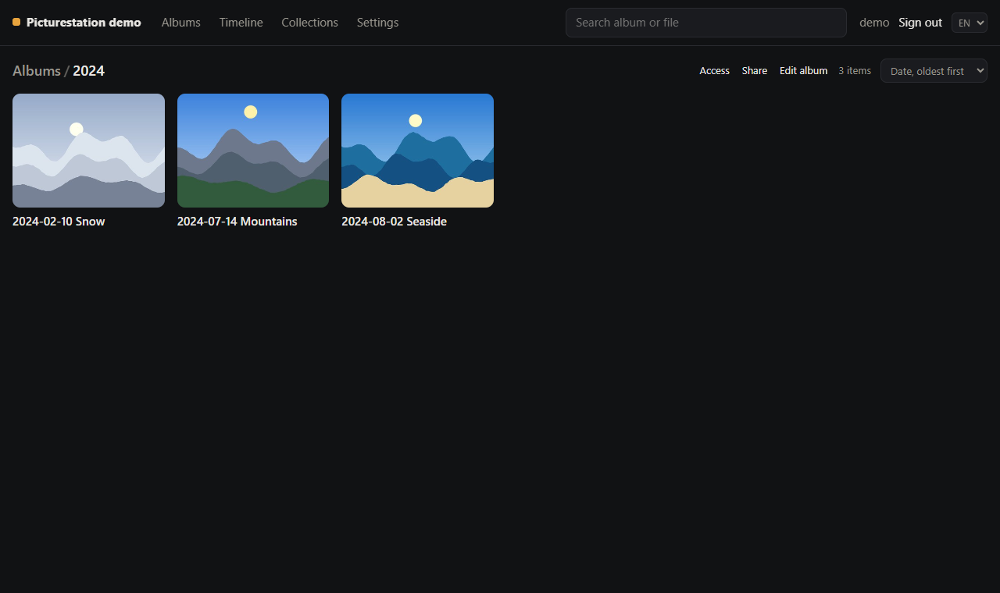
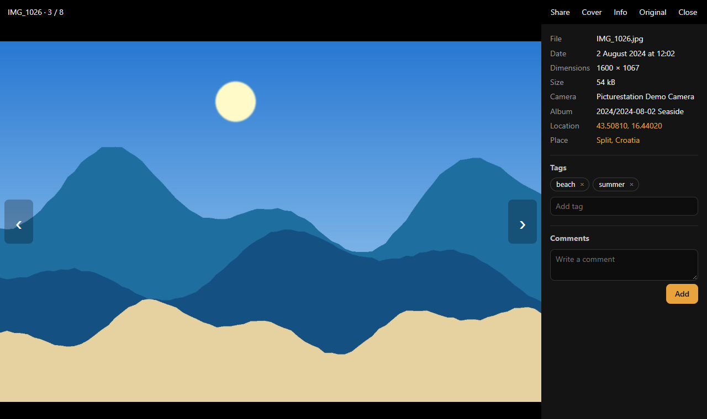
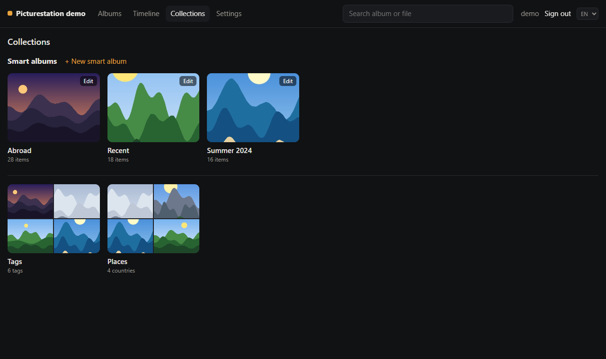
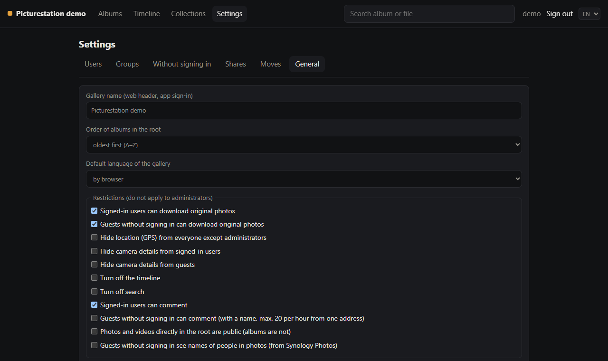

# Picturestation


**A Photo Station 6 compatible photo gallery for Synology DSM 7.** [Slovensky](README.sk.md)

Synology removed Photo Station in DSM 7. Its replacement, Synology Photos, works differently: it has no per-album rights for groups, no guest albums with passwords, and the DS photo app no longer connects. Picturestation brings that back. It is a small server that reads your photo folder read-only and offers:

- **a web gallery** with albums, a timeline, search, tags, places, people and smart albums, in English and Slovak;
- **the DS photo app** (Android), which connects to it as if it were Photo Station 6;
- **an app for LG TVs** (webOS 3.0 and later) and **an app for Android and Android TV**: albums, the newest photos, viewer, slideshows and videos; a device is paired with a code, without a password;
- **Photo Station style rights**: users, groups, guest access, password-protected albums, excluded albums, share links with expiry;
- **people and tags from Synology Photos**: face recognition and tagging stay in Synology Photos, Picturestation shows the named people and the tags;
- **iPhone photos**: HEIC with dates and places (with exiftool), and Live Photos as one item whose motion plays in the viewer;
- **thumbnails** that DSM already made in `@eaDir`, and its own cache for the rest.

Your photos are never changed. Picturestation needs read access only and keeps its own data (users, rights, comments, thumbnail cache) in one folder.

Picturestation is not affiliated with or endorsed by Synology. Synology, DSM, Photo Station, DS photo and Synology Photos are trademarks of Synology Inc.



| Viewer with details, tags and comments | Collections: smart albums, tags, places, people |
|---|---|
|  |  |

## Contents

- [How it fits together](#how-it-fits-together)
- [Install on Proxmox VE](#install-on-proxmox-ve)
- [Install on Debian 13](#install-on-debian-13)
- [Docker and Synology Container Manager](#docker-and-synology-container-manager)
- [Share the photo folder from DSM over NFS](#share-the-photo-folder-from-dsm-over-nfs)
- [HTTPS and your own domain](#https-and-your-own-domain)
- [The DS photo app](#the-ds-photo-app)
- [The LG TV app](#the-lg-tv-app)
- [The Android app](#the-android-app)
- [People from Synology Photos](#people-from-synology-photos)
- [Personal galleries](#personal-galleries)
- [Moving from Photo Station 6](#moving-from-photo-station-6)
- [Administration](#administration)
- [Versions and updates](#versions-and-updates)
- [Backup](#backup)
- [Development](#development)

## How it fits together

```
 phone (DS photo) ─┐                         ┌─ NAS (DSM 7)
 browser ──────────┼─ HTTPS ─ DSM reverse ───┤   share "photo" ── NFS read-only ──┐
                   │          proxy          │   Synology Photos API (optional) ──┤
                   └─────────────────────────┘                                    │
                                     Picturestation (LXC or VM, Debian 13) ◄──────┘
```

Picturestation runs outside the NAS, in a small container or virtual machine. It mounts the photo share read-only over NFS. The DSM reverse proxy gives it a domain name and an HTTPS certificate.

## Install on Proxmox VE

Run this as root in the shell of your Proxmox host:

```sh
bash -c "$(curl -fsSL https://raw.githubusercontent.com/valdaaak/picturestation/main/install/proxmox.sh)"
```

The installer asks four questions:

1. **Container or virtual machine.** A container (LXC) is lighter and is the default.
2. **Host name.**
3. **IP address**, either DHCP or a static address such as `192.168.1.50/24` plus the gateway.
4. **NFS export with your photos**, for example `192.168.1.10:/volume1/photo`. Prepare it first, see [the NFS section](#share-the-photo-folder-from-dsm-over-nfs).

At the end it prints the address and the administrator password. Sign in as `admin` and change the password in **Settings, Users**.

Everything can also be given as options, without questions:

```sh
proxmox.sh --yes --type lxc --ip dhcp --nfs 192.168.1.10:/volume1/photo
proxmox.sh --yes --type vm --id 120 --ip 192.168.1.50/24 --gw 192.168.1.1 --memory 2048 --nfs 192.168.1.10:/volume1/photo
```

`proxmox.sh --help` lists all options.

**Where the NFS export is mounted:**
- **In a container**, the Proxmox host mounts it and passes it into the container read-only, because an unprivileged container cannot mount NFS itself. The files must be readable by "others", which is the usual case for a DSM share exported with *Map all users to admin*. If they are not, use a virtual machine.
- **In a virtual machine**, the VM mounts the export itself.

**Resources.** The default is 2 GB of RAM and 2 cores. A small library uses about 250 MB, of which the place-name database takes about 200 MB. A library of 70,000 photos uses about 1 GB. Thumbnails that DSM has not made yet are generated on the first view, which needs CPU for a while.

## Install on Debian 13

On any Debian 13 (trixie) machine, as root:

```sh
apt install git
git clone https://github.com/valdaaak/picturestation.git /opt/picturestation-src
sh /opt/picturestation-src/install/install.sh --nfs 192.168.1.10:/volume1/photo
```

The installer can be run again at any time. These are its options:

| Option | Meaning |
|---|---|
| `--photos DIR` | photo folder, default `/mnt/photo` |
| `--nfs SERVER:/export` | mount this export read-only at the photo folder (fstab, automount) |
| `--port N` | HTTP port, default 80 |
| `--title TEXT` | gallery name |
| `--admin NAME` | first administrator, default `admin` |
| `--admin-pass-file FILE` | write the generated password to a file instead of printing it |
| `--update` | install a new version only, keep the settings |

**To update:**

```sh
git -C /opt/picturestation-src pull
sh /opt/picturestation-src/install/install.sh --update
```

**Settings** are in `/etc/picturestation/picturestation.env`, see [the example](install/picturestation.env.example). After a change, run `systemctl restart picturestation`.

## Docker and Synology Container Manager

Picturestation can also run in a container directly on the NAS, without NFS:

```sh
docker run -d --name picturestation --restart unless-stopped -p 8080:8080 \
  -v /volume1/photo:/photos:ro -v /volume1/docker/picturestation:/data \
  -e PUID=1026 -e PGID=100 ghcr.io/valdaaak/picturestation
```

**In Synology Container Manager:**
1. Create the folder `docker/picturestation` in File Station.
2. Open **Project, Create**, choose that folder and paste [docker-compose.yml](docker-compose.yml).
3. Adjust the paths and `PUID`/`PGID`. They must be the id of a DSM user who can write to the data folder. `id <user>` over SSH shows it, and 1026/100 is the usual first user.

**First start.** It downloads the place names, creates the user `admin` and prints its password in the container log. The password is also saved in `/data/admin-password.txt`; delete that file after you change the password.

**Settings.** They are environment variables with the same names as in [the settings example](install/picturestation.env.example). For the people sync, put the password file into the data folder and set `SYNO_PASS_FILE=/data/synology.pass`.

**Behind the DSM reverse proxy**, set `PICTURESTATION_TRUSTED_PROXIES` to the gateway of the Docker network. `docker network inspect bridge` shows it, usually `172.17.0.1`.

**User management:** `docker exec -it picturestation picturestation-user list`.

**To update:** pull the new image and recreate the container. The data folder stays.

## Share the photo folder from DSM over NFS

1. In **Control Panel, File Services, NFS**, turn on NFS. NFSv4.1 is recommended.
2. In **Control Panel, Shared Folder**, select `photo`, choose **Edit, NFS Permissions** and **Create** a rule:
   - Hostname or IP: the address of Picturestation (or of the Proxmox host when you use a container)
   - Privilege: **Read only**
   - Squash: **Map all users to admin**
   - Security: **sys**
   - **Allow users to access mounted subfolders**: on
3. The same dialog shows the mount path, for example `/volume1/photo`. Use it as `SERVER:/volume1/photo`.

Picturestation never writes to the share. Its thumbnails and database live on its own disk.

## HTTPS and your own domain

DSM can publish Picturestation under a domain name with a Let's Encrypt certificate:

1. **DNS.** Point a name such as `photos.example.com` to your public IP and forward ports 80 and 443 to the NAS.
2. **Reverse proxy.** In **Control Panel, Login Portal, Advanced, Reverse Proxy**, choose **Create**:
   - Source: HTTPS, `photos.example.com`, port 443
   - Destination: HTTP, the Picturestation address, port 80
   - **Custom Header**: add `X-Forwarded-For` with the value `$proxy_add_x_forwarded_for`
3. **Certificate.** In **Control Panel, Security, Certificate**, choose **Add, Get a certificate from Let's Encrypt** for the name. Then, under **Settings**, assign it to the reverse proxy entry. DSM renews certificates but does not always reassign them, so check the assignment after a renewal.
4. **Trust the proxy.** Add the address of the NAS to `PICTURESTATION_TRUSTED_PROXIES` in the settings file. The log and the login limit then see the real client address.

## The DS photo app

The DS photo app connects in the usual way. It was tested with the Android app 3.12.

- **Address:** the domain or IP of Picturestation
- **User name and password:** a Picturestation user, not a DSM account
- **HTTPS** when you use the reverse proxy

The app can browse albums, the timeline, tags, places, smart albums and comments, and it can download photos and play videos. Uploads and edits are refused because Picturestation is read-only. The app plays video over plain HTTP, so keep port 80 reachable if you watch videos on the go.

## The LG TV app

`LGTV/` holds an app for LG TVs with webOS 3.0 or later: albums, the newest photos, a full-screen viewer, slideshows and videos, driven by the remote control. It is installed through LG's Developer Mode; [LGTV/README.md](LGTV/README.md) has the steps. The TV is paired without a password: it shows a code, and an administrator allows it under **Settings, TV** for a chosen user. The TV stays signed in until it is removed there.

## The Android app

`Android/` holds one app for phones, tablets and Android TV (Android 8.0 and later): albums, the newest photos, a viewer with zoom, people and place, videos, slideshows and sharing a photo; on a TV it has a launcher banner and works with the remote. It is paired like the LG TV app, with a code allowed under **Settings, TV**. [Android/README.md](Android/README.md) has the build and install steps; the APK is installed by hand (or over adb on a TV), it is not in an app store.

## People from Synology Photos

Synology Photos recognises faces and lets you name people. Picturestation can show these people with their photos:

1. In DSM, create a user, for example `picturestation-sync`, with no rights to shared folders.
2. In **Synology Photos, Settings, Shared Space**, give this user **Full Access**. Synology lists people only for accounts with full access. Picturestation calls read APIs only, but the account could delete photos in Synology Photos, so keep its password safe. Turn on the recycle bin for the shared space as a precaution.
3. On the Picturestation machine:

   ```sh
   (umask 077; cat > /etc/picturestation/synology.pass)   # type the password, Enter, then Ctrl+D
   chown picturestation /etc/picturestation/synology.pass
   ```

   Then add the following lines to `/etc/picturestation/picturestation.env` and restart:

   ```
   SYNO_URL=https://nas.example.com:5001
   SYNO_USER=picturestation-sync
   SYNO_PASS_FILE=/etc/picturestation/synology.pass
   ```

People are synchronised at every index run, every 30 minutes with the default settings. Only people with a name appear. Each user sees only the people on photos they are allowed to see. Guests see names only when the restriction **Guests without signing in see names of people** is turned on.

The same run takes the **tags** of the shared space (Synology Photos' general tags) into the gallery's tags: a tag added in Synology Photos appears on the photo, a tag removed there disappears. Keywords written in the files and tags added in the gallery stay as they are. A Synology tag that an administrator removes from a photo in the gallery is not added again. Only the main gallery is synchronised: the service account sees the shared space, not the users' personal spaces.

## Personal galleries

Photo Station had personal galleries in each user's home folder. Picturestation serves any number of private galleries next to the main one, from the same server and port. Each private gallery has its own photo folder, users, administrators, rights, thumbnails and database. The main gallery's users have no access to it.

The main gallery's administrator manages them under **Settings, Galleries**:

- **New gallery:** a name, a title, the photo folder, optional domains, and the first administrator with a password.
- **Edit:** change the title, folder or domains, or turn the gallery off.
- **Administrators:** add one or set a new password. The gallery's administrator manages its other users in that gallery's own Settings.
- **Delete:** the gallery's database and thumbnails are moved to `galleries/.deleted`. The photos are not touched.

**Addresses.** A gallery is reachable at `http://server/~name/`. In the DS photo app, enter the name in **Personal Photo Station account**. With a domain such as `alice.example.com`, create a reverse proxy in DSM from that domain to the same server and port as the main gallery. Picturestation picks the gallery by the host name.

**Photo folders** must be below `PICTURESTATION_GALLERY_ROOTS`, by default `/srv/galleries` and `/mnt/galleries`, so that the web cannot open other folders of the server. For a folder on the NAS, mount it read-only below `/mnt/galleries`. For example, add an NFS rule for the `homes` share and put this in `/etc/fstab`:

```
192.168.1.10:/volume1/homes/alice/Photos /mnt/galleries/alice nfs4 ro,soft,timeo=100,retrans=3,nofail,_netdev,x-systemd.automount 0 0
```

All galleries run the same code. An update of Picturestation applies to all of them at once.

## Moving from Photo Station 6

These importers are optional and run once:

- **Users, groups and album rights** from a Photo Station database export: `python3 -m picturestation.ps_import EXPORT.sql`. Without `--apply` it only shows what it would do. Users get new random passwords, because Photo Station passwords cannot be carried over.
- **Tags and albums** from Synology Photos: `python3 -m picturestation.synofoto_import FOLDER`, where the folder holds `.tsv` exports of the Synology Photos database. The module help lists the files.
- **Album titles, descriptions and covers** that Photo Station wrote into `@eaDir` are read automatically.

## Administration

The administrator configures everything in the web gallery under **Settings**:

- users and groups;
- album access as a tree, with allowed and excluded albums;
- guest access and share links;
- restrictions: downloads, GPS, camera details, comments, timeline, search;
- the gallery name, album order and default language.



**Moving folders.** When you move or rename folders on disk, for example at the end of the year, Picturestation recognises them by their files. It then carries over rights, titles, covers, tags, comments and links. **Settings, Moves** lists what could not be matched automatically.

**Command line:**

```sh
picturestation-user list
picturestation-user useradd jana
picturestation-user grant jana "2024/2024-07-14 Mountains"
picturestation-user --help
```

## Versions and updates

Picturestation uses semantic versioning. Releases are git tags such as `v0.1.0` and are listed in [CHANGELOG.md](CHANGELOG.md). The running version is shown at the bottom of **Settings, General**, in the log at start, and by `picturestation-user --version`.

To update to a specific release on Debian or in a Proxmox guest:

```sh
git -C /opt/picturestation-src fetch --tags
git -C /opt/picturestation-src checkout v0.1.0
sh /opt/picturestation-src/install/install.sh --update
```

## Backup

Everything Picturestation knows is in `/var/lib/picturestation`:

- the database `picturestation.sqlite`;
- the thumbnail cache, which can be rebuilt;
- the place-name data, which can be downloaded again.

Back up the database, or the whole container or VM with Proxmox backup. Settings are in `/etc/picturestation`.

## Development

```sh
cd server
python3 tests/test_api.py /tmp/ps-test     # server and API (needs python3-starlette, -uvicorn, -pil, -httpx)
python3 tests/test_cookie.py /tmp/ps-cookie
python3 tests/test_i18n.py                 # every text has a translation
python3 tools/make_demo.py /tmp/demo       # demo library with generated photos
```

The browser checks in `server/tests/*_check.py` use Playwright with Microsoft Edge against a running gallery.

The protocol that the DS photo app expects is described in [docs/protocol.md](docs/protocol.md).

**Layout.** The server is the Python package in `server/picturestation`, the web gallery is `web/` (HTML, CSS, JS; installed to `/opt/picturestation/web`, or wherever `PICTURESTATION_WEB_DIR` points), the installers are in `install/`.

**Translations.** Web texts are in English in the code, with Slovak in `web/i18n.js`. Server messages are in `server/picturestation/i18n.py`. A new language needs a dictionary in each of these files and its code in the language checks there.

## License

[GPL-3.0-or-later](LICENSE).

Place names come from [GeoNames](https://www.geonames.org/) (CC BY 4.0). They are downloaded during installation.
